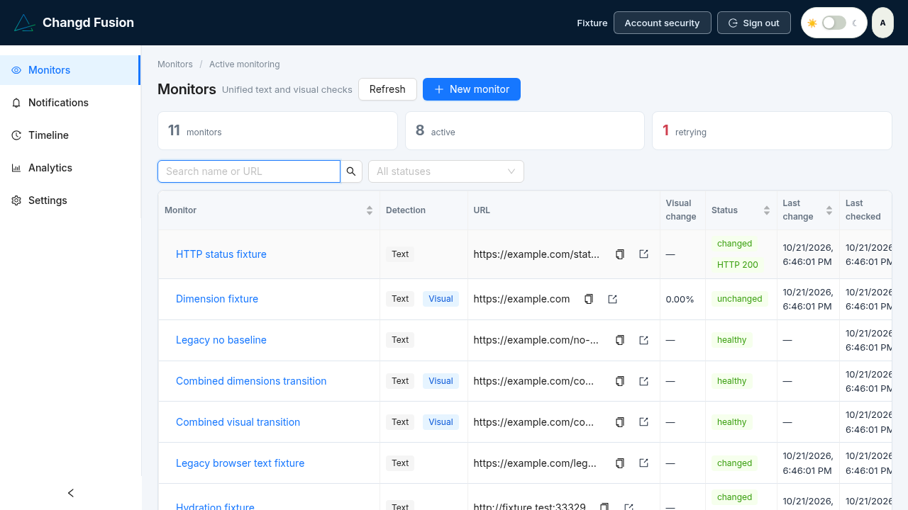
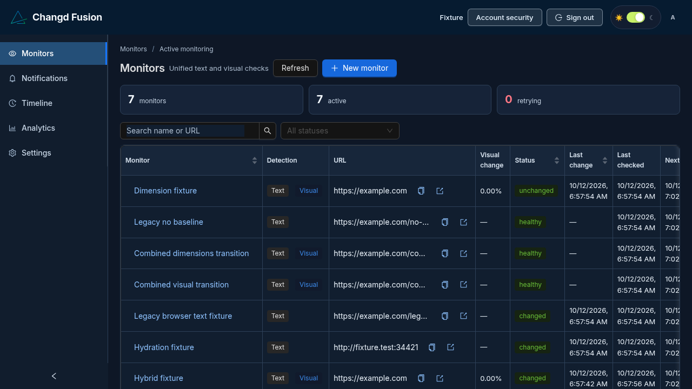
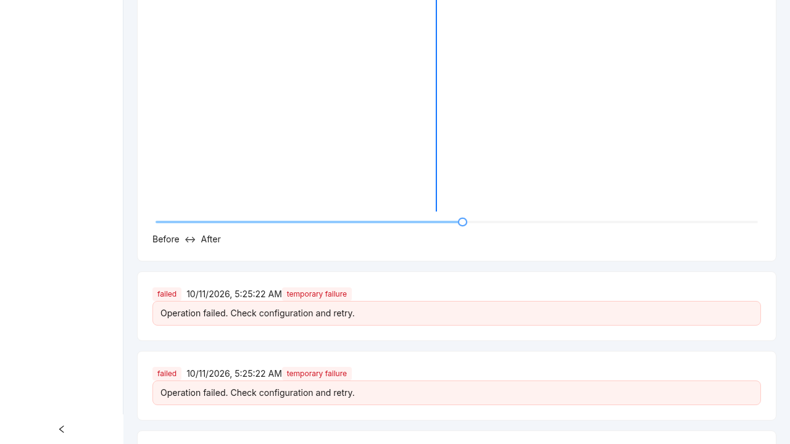
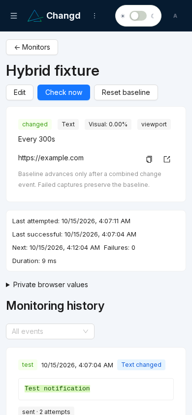
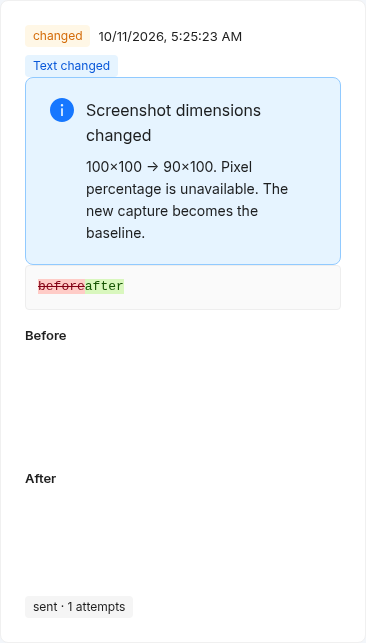
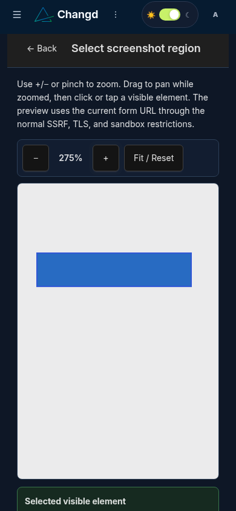
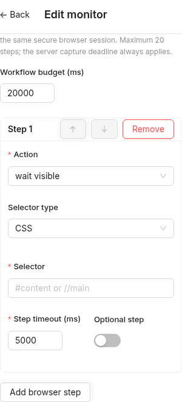
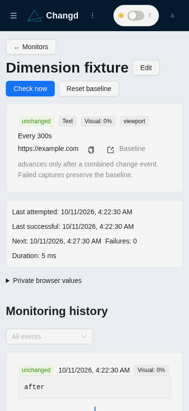
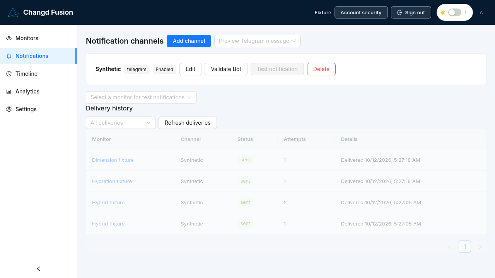

# 🔭 Changd Fusion

### See what changed. Know what matters.

**A modern, self-hosted website monitoring platform for visual, text, API, and file changes.**

One Docker container · SQLite WAL · Chromium / Playwright · Responsive light & dark UI · Telegram & email alerts

**[Features](#what-you-can-monitor) · [Screenshots](#screenshots) · [Quick start](#quick-start) · [Architecture](#architecture) · [Operations](#operations-backup-and-upgrades) · [Credits](#origins-credits-and-development)**

  <picture>
    <source media="(prefers-color-scheme: dark)" srcset="docs/images/dashboard-desktop-dark.png">
    
  </picture>

> **A community-maintained fork of [Changd](https://github.com/paschmann/changd) by [Paul Aschmann](https://github.com/paschmann).** Fusion builds on the original project's idea of self-hosted change detection while offering a substantially expanded monitoring workflow and a simplified deployment model. This is an independent derivative project, not an official upstream release.

## Why Changd Fusion?

Sometimes a page changes in one small place. Sometimes its text, price, visual layout, HTTP status, or downloadable file metadata changes. Fusion brings these signals into **one monitor** and gives you the tools to choose exactly what matters, see the before/after evidence, and receive an actionable notification.

- **Run it yourself.** One application container and one persistent volume; no PostgreSQL, Redis, or external SaaS account is required for core monitoring.
- **Monitor intelligently.** Combine text and screenshots, target a CSS/XPath element or rectangle, and replay browser interactions before capture.
- **Make it visual.** Interactive previews, mobile-friendly selection, image comparisons, change timelines, and analytics.
- **Get useful alerts.** Telegram and SMTP, including a short **Before → After → Diff MP4** for eligible visual changes.
- **Control the noise.** Ignore/mask dynamic regions, configure thresholds, filter notification direction, mute alerts, or use digest delivery.

## What you can monitor

| Capability | What it does |
| --- | --- |
| 🖼️ **Visual changes** | Compare viewport, full-page, selected-element, or selected-area screenshots; inspect before/after and diff evidence. |
| 📝 **Text changes** | Watch visible text or a CSS/XPath target, detect added/removed content, compare selected values, or track keyword presence. |
| 🔀 **Hybrid monitors** | Combine text and visual detection in the same browser workflow, with independent comparison options. |
| 🧭 **Browser Steps** | Replay click, wait, scroll, select, fill, navigation-wait, and cookie-dismissal steps before capturing. |
| 📄 **API / HTML** | Track API/JSON responses and HTML source without needing a visual screenshot. |
| 📦 **File Monitor** | Detect changes to file endpoints (including APK URLs) from HTTP status, ETag, Last-Modified, and Content-Length via HEAD / bounded Range GET—without downloading the full file. |
| 📖 **Reader sources** | Use **Jina Reader** or **markdown.new** alongside direct browser text. markdown.new offers Auto and Browser Rendering modes. |
| 🛡️ **Ad & tracker blocking** | Optional **Ghostery** network filtering with a pinned EasyList/EasyPrivacy snapshot; enabled per monitor. |
| 🔔 **Alerts & history** | Telegram, SMTP, failed-capture/attention alerts, notification cooldowns and digests, monitoring history, Timeline, and Analytics. |

**Reader privacy:** Selecting Jina Reader or markdown.new sends the target URL to that third-party service. A successful provider response does **not** guarantee that the actual page content was retrieved; anti-bot or challenge pages may still be returned.

## Screenshots

The images below are included in this repository, so the gallery works on GitHub without a hosted image service.

### Light & dark desktop dashboard

| Light theme | Dark theme |
| :---: | :---: |
|  |  |

### History, visual comparison, and responsive layout

| Desktop monitoring history | Mobile monitoring history | Dimension-aware visual comparison |
| :---: | :---: | :---: |
|  |  |  |

### Configure and interact on mobile

| Interactive element Preview | Visual Browser Steps | Screenshot and capture settings |
| :---: | :---: | :---: |
|  |  |  |

### Notifications

  

**Telegram visual change preview:** When before, after, and diff images are available, Fusion can produce an approximately six-second, silent H.264 MP4 (about two seconds per frame) and send it using Telegram's video API. When video prerequisites are unavailable, the existing image notification path is retained. Caption-length handling may use an additional text message when required.

## From Changd to Fusion

[Original Changd](https://github.com/paschmann/changd) provided an open-source foundation for monitoring visual changes, XPath/API data, screenshot history, and email notifications. Fusion retains that spirit but is **not a drop-in deployment of the upstream application**.

| Area | Original Changd | Changd Fusion |
| --- | --- | --- |
| Application deployment | Node frontend/backend and PostgreSQL-based stack | **One Docker service**, embedded SQLite WAL and one persistent data volume |
| Browser-driven monitoring | Screenshot and XPath/API-oriented monitoring | **Chromium/Playwright**, hybrid text + visual monitors, interactive element/area selection |
| Interaction before capture | Basic page monitoring | **Browser Steps** with replayable scrolling and element actions |
| Text alternatives | Direct HTML/XPath/API | Direct extraction plus **Jina Reader** and **markdown.new** |
| Downloadable files | Website/API-oriented change monitoring | **HTTP metadata File Monitor** with bounded requests |
| Notifications | Primarily email and screenshot notifications | **Telegram + SMTP**, visual MP4, failure/attention alerts, cooldown and digest options |
| Interface | Original React application | **Responsive light/dark interface**, mobile Preview, Timeline and Analytics |
| Noise reduction | Original comparison controls | Visual thresholds, ignored/masked regions, cookie handling, **Ghostery** network filters |

The comparison describes project direction and capabilities; check upstream for its own current features and roadmap.

## Interactive monitoring workflow

1. **Choose a source:** Browser, API/JSON, HTML source, or File Monitor.
2. **Choose the signal:** Text, visual, or both (for browser sources).
3. **Select the target:** Full text, keyword, CSS/XPath selector, viewport, full page, selected element, or selected area.
4. **Prepare the page:** Add Browser Steps, disable JavaScript if appropriate, reject eligible cookie banners, and optionally block ads/trackers.
5. **Preview and save:** Interactively scroll or zoom, pick the desired target, and let the browser replay the saved steps on subsequent runs.
6. **Receive and investigate:** Check Now, scheduled monitoring, Telegram/SMTP notifications, Before/After evidence, History, Timeline, and Analytics.

Interactive Preview prioritizes active user work over scheduled Chromium capture. Scroll activity can extend a live preview beyond its initial 45 seconds, with a bounded three-minute maximum. It remains a screenshot-driven preview of an isolated server-side browser, not an unrestricted remote browser.

## Quick start

### Requirements

- Docker Engine and **Docker Compose v2**.
- A Linux x86-64 host (the platform exercised by CI).
- Enough available memory for Chromium: **2 GiB RAM is a reasonable starting point**, not a formally measured minimum.
- An HTTPS reverse proxy for publicly accessible installations.

The application is designed for **one instance**, not an HA or multi-replica cluster. The default Compose configuration binds its HTTP port to **127.0.0.1**, not the public network interface.

### Install with Docker Compose

~~~bash
git clone https://github.com/mkaand/changd-fusion.git
cd changd-fusion
cp .env.example .env
docker compose up -d --build
docker compose exec fusion cat /data/setup-token
~~~

Open **http://localhost:8127/setup**, enter the one-time setup token, and create the first administrator account.

For external HTTPS access, set `FUSION_SIMPLE_PUBLIC_URL=https://your-domain.example` in `.env`, configure your reverse proxy, then recreate the service:

~~~bash
docker compose up -d --no-deps fusion
~~~

The port is configurable using `FUSION_SIMPLE_PORT` (default `8127`). Do **not** expose the service directly to the internet without TLS and suitable access controls.

## Architecture

~~~text
                       Changd Fusion
                   (single Docker service)
                              |
           +------------------+------------------+
           |                  |                  |
      React / AntD        Node.js API       Scheduler / Outbox
       Responsive         Auth & config      Telegram / SMTP
           |                  |                  |
           +------------------+------------------+
                              |
                      Chromium / Playwright
                    isolated capture processes
                              |
                      SQLite WAL + artifacts
                    one persistent /data volume
~~~

- **One service:** `fusion` contains the UI, API, scheduler, notification queue, and sandboxed Chromium capture runtime.
- **One persistent volume:** `changd-fusion-data` stores SQLite/WAL, captures, encrypted channel and private-value data, and setup state.
- **One browser capacity coordinator:** Check Now and interactive previews take priority over scheduled capture, with bounded cancellation and cleanup.
- **No mandatory external database or queue.** Server capture/validation code is compiled into the same image.
- **No production-specific dependency:** HestiaCP, Cloudflare, country-specific egress relays, and private reverse-proxy conventions are *not* required for a normal installation.

The canonical Compose identities are project `changd-fusion`, service `fusion`, container `changd-fusion`, volume `changd-fusion-data`, and network `changd-fusion_default`. `compose.simple.yml` is retained as an equivalent Simple entrypoint.

## Notifications, filtering & privacy

**Telegram & SMTP.** Configure notification channels in Settings and assign channels per monitor. Change notifications can carry text summaries and visual evidence. Failed captures, persistent problems, and authentication/challenge states can be tracked separately. Per-monitor cooldown, mute, and digest settings reduce noise.

**Ad & tracker blocking.** The `Block ads & trackers` switch uses `@ghostery/adblocker` with a pinned, verified EasyList/EasyPrivacy **network-only** snapshot. Filters ship inside the image; runtime checks do not download new lists. Cosmetic element hiding/scriptlet injection is *not* enabled. Filter exceptions never override the application's network security policy. See [filter provenance and maintenance](docs/ghostery-filters.md).

**Private data & secure egress.** Monitoring uses owner-scoped storage, authenticated sessions, same-origin request protections, scoped outbound network policy, Chromium sandboxing and resource limits. HTTPS certificates are validated. Private browser values have an encrypted, write-only configuration path. Public Access, when enabled by an administrator, intentionally exposes workspace functions—enable it only if that is your intended access model.

**External readers are optional.** Jina Reader and markdown.new are third-party services. The core Chromium/Text/Visual/File Monitor workflows do not depend on them.

## Operations, backup and upgrades

~~~bash
docker compose ps
docker compose logs --tail=100 fusion
docker compose restart fusion
docker compose stop fusion
docker compose start fusion
~~~

**Back up the complete volume, including SQLite WAL files and screenshots.** For a straightforward offline snapshot:

~~~bash
umask 077
docker compose stop fusion
docker run --rm -v changd-fusion-data:/data:ro -v "$PWD":/backup alpine:3.21 sh -c 'cd /data && tar -czf /backup/fusion-simple-backup.tar.gz .'
docker compose start fusion
~~~

Treat backup archives as sensitive because they contain account and notification secrets. Restore only to a stopped instance after making a separate, verified rollback copy; preserve ownership and permissions. Never restore directly over a running SQLite database.

**Do not run `docker compose down -v` or volume prune** during ordinary maintenance: deleting the named volume destroys application data.

### Updating

Clones build locally by default. No automatic updater is installed or enabled for them. To upgrade manually, note the prior commit, back up `/data`, pull a reviewed revision, and rebuild/recreate the service.

Successful `master` CI publishes a linux/amd64 image to **`ghcr.io/mkaand/changd-fusion`**, tagged with the full commit SHA and `master`. The application version is also recorded in image metadata. Operators may opt into digest-pinned GHCR deployment with `docker-compose.ghcr.yml`, using `--no-build` in production.

The optional updater under `deploy/` periodically checks the approved image and performs guarded health/SQLite checks with a controlled rollback path. It is **not automatic for new installations**. Follow the [updater runbook](deploy/README.md) to review, bootstrap, and activate it deliberately. GitHub itself has no production VPS credentials.

### Existing Simple installations and legacy imports

Earlier Simple deployments used project `changd-fusion-simple` and a differently named data volume. Docker does not rename volumes. **Do not start the current Compose project against an empty new volume before migrating data.** Stop the old service, verify an offline backup, inspect both volumes, copy all stopped `/data` contents (including WAL and artifacts) with original ownership, and verify the new instance before retiring rollback material. Keep the original volume until acceptance.

For older PostgreSQL installations, the optional one-time `simple/export-pg.mjs` and `simple/import-settings.mjs` tools can migrate settings, monitors, encrypted channels/private values, and relationships into an **empty** SQLite instance. PostgreSQL is used only for export. Historical captures are not migrated; fresh baselines are created without artificial change notifications. Preserve the original `CHANNEL_KEY` and never print secrets.

## Quality & security checks

[GitHub Actions](https://github.com/mkaand/changd-fusion/actions/workflows/simple-ci.yml) checks backend/frontend builds, SQLite persistence and compatibility, actual single-container build, real Chromium capture and Preview, queue cleanup, notifications, initial administrator setup, and image metadata. Image publishing from `master` follows the required CI gates.

Core runtime dependencies and shipped filter snapshots are pinned or verified. The design favors predictable behavior, isolated browser operations, clean cancellation, and preservation of captures and history.

## Project status

**Feature-complete and in maintenance.** Changd Fusion v0.4.7 represents the consolidated Simple/SQLite architecture and the principal monitoring features described above. Future updates may include targeted fixes, security and dependency maintenance, documentation improvements, and small quality-of-life enhancements. This does not imply that every website or anti-bot protection is compatible with every capture mode.

Contributions, reproducible bug reports, and documentation improvements are welcome through [GitHub Issues](https://github.com/mkaand/changd-fusion/issues).

## Origins, credits and development

- **Original project:** [Changd](https://github.com/paschmann/changd) created by **Paul Aschmann**. Thank you for the original concept and open-source foundation.
- **Fusion fork and product direction:** [mkaand](https://github.com/mkaand). Architecture, priorities, acceptance criteria and release decisions were human-directed.
- **AI-assisted engineering:** **OpenAI Codex**, including a Codex Cloud development workspace (`Cloud_2`), assisted with implementation, tests, refactoring and documentation. Changes were reviewed and verified through GitHub CI and product acceptance testing. This project is **not affiliated with or endorsed by OpenAI**.
- **Components and acknowledgements:** Chromium/Playwright, React, Ant Design, SQLite, Ghostery Adblocker, EasyList/EasyPrivacy and other open-source dependencies, subject to their respective licences.

**Licence:** [MIT](license), preserving the original Changd copyright notice. See [third-party notices](docs/third-party/) and [filter licence/provenance](docs/ghostery-filters.md) for additional attribution.

---

  <strong>Own your monitoring. Keep your history. Know what changed.</strong>

