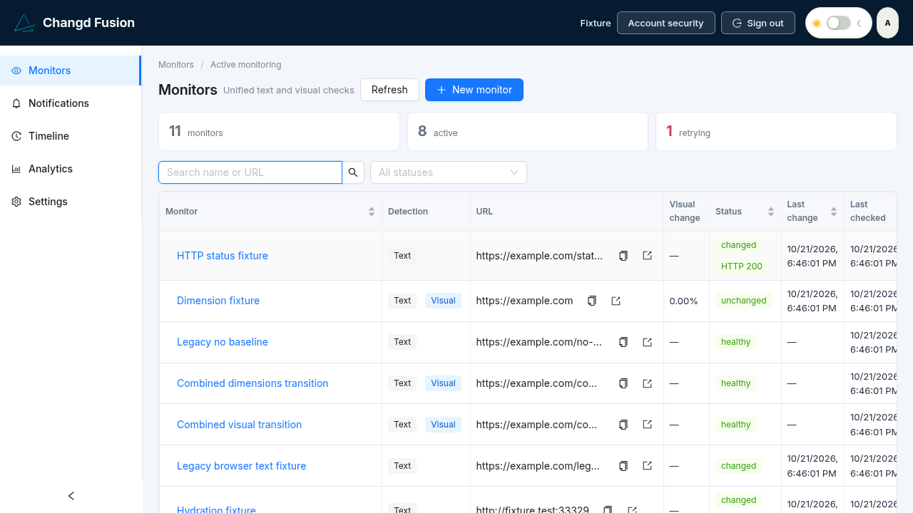
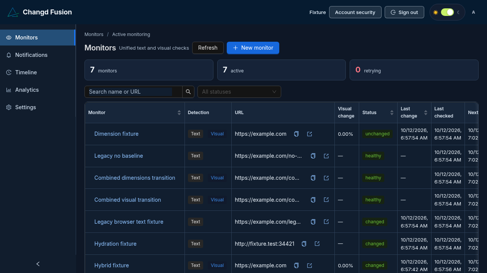
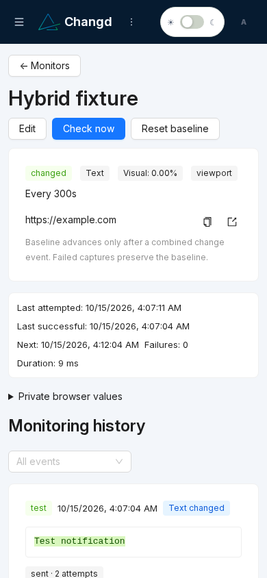
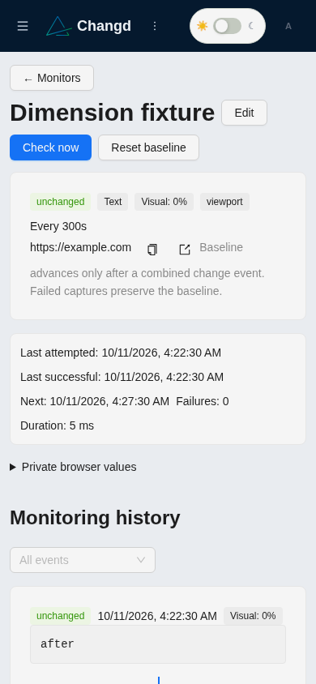
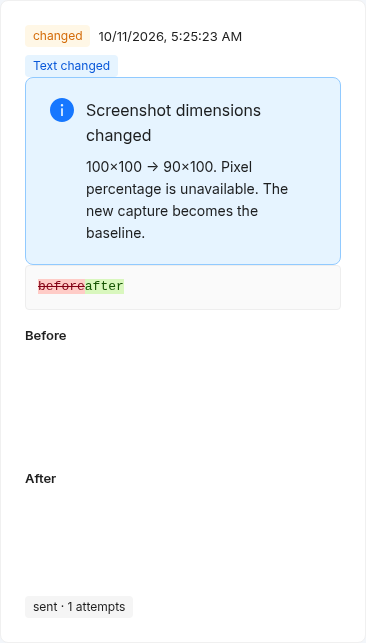
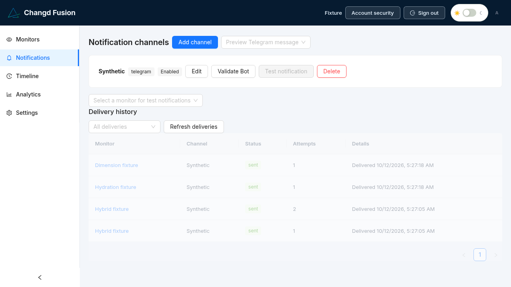
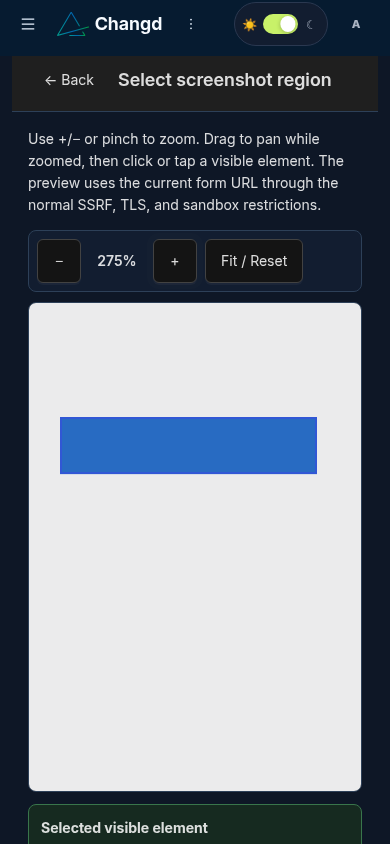

# Changd Fusion

> A self-hosted Changd fork for unified text and visual website monitoring.



Changd Fusion combines text extraction and screenshot comparison in one monitor, one browser capture, one schedule, and one combined event pipeline. It is based on [Changd by Paul Aschmann](https://github.com/paschmann/changd) and preserves the upstream project's MIT attribution while modernising the supported stack.

| Desktop dark mode | Responsive mobile dashboard |
| --- | --- |
|  |  |

| Mobile monitor Advanced Settings | Mobile visual-monitor history |
| --- | --- |
|  |  |

## Features

- **Unified monitoring** — browser text, visual, HTML and API monitoring with CSS/XPath extraction, masks, ignore rules, decimal-safe Pixelmatch comparison and structural dimension-change events. Browser text capture follows rendered visible content and excludes scripts, templates and hidden hydration state; raw HTML and API/JSON modes retain source semantics. Capture failures persist only safe stage/code categories and duration—never raw exceptions, URLs, headers, page content, or credentials. A legacy browser text baseline transitions silently on its next successful capture; its current screenshot is adopted too, so a one-time visual change is intentionally absorbed rather than notified.
- **Focused text notifications** — one shared **Notification direction** radio group applies to every text-monitoring mode: Added only, Removed only, or Added & Removed (the default). Existing monitor values remain compatible. The setting filters delivery only: captures, baselines, History and Timeline keep the complete change record. Visual alerts are independent of the text direction rule.
- **Optional Jina Reader source** — text-only Browser monitors may explicitly use Jina Reader. The monitored URL is sent to the third-party reader; this is shown in the editor before saving. Jina supports Full Text Changes, Selected Text / Value and Keyword Presence. Ambiguous, missing, challenge, or invalid reader content fails safely and keeps the previous baseline. Chromium visual capture, Browser Steps, private values, CAPTCHA bypass and authenticated browsing are never routed through Jina.
- **Browser steps** — validated waits, clicks, scrolling, select and safe form actions run in the same sandboxed Playwright session as capture.
- **Visual history** — before/after/diff artifacts, comparison slider, pagination and retention-aware storage.
- **Smart notifications** — SMTP and Telegram channels, encrypted credentials, fixed-host TLS delivery, outbox retries, concise redacted summaries, mute/cooldown, duplicate suppression and durable monitor digests.
- **Operations** — channel validation, explicit test notifications, delivery history, monitoring defaults, bulk channel assignment and owner-scoped diagnostics.
- **Responsive interface** — a compact upstream-inspired desktop dashboard plus mobile drawer, monitor cards and safe-area layouts. The included AllMy Light/Dark/Auto control follows system preference and persists non-sensitive preference only.
- **Security** — owner checks, server-side session revocation, HttpOnly cookies, CSRF/origin validation, SSRF/DNS rebinding restrictions, sandboxed Chromium and bounded capture resources.



## Text monitoring modes

**Full Text Changes** compares the complete extracted text and reports added and removed content. Direct Browser monitors can optionally narrow that text with a CSS or XPath selector. **Selected Text / Value** is available with Jina Reader and uses the Text Picker to create a contextual V1/V2 rule for one changing value; a rule must resolve unambiguously or extraction fails closed. **Keyword Presence** works with both Direct Browser and Jina Reader and watches for a literal, Unicode-aware, case-insensitive whole word or phrase without using a visual picker or user-supplied regular expression.

Keyword Presence records explicit state transitions: absent → present is **Added**, present → absent is **Removed**, and an unchanged presence state produces no text-change event even if other page text changes. The first successful capture establishes the baseline without notifying, and a capture failure preserves the last known state rather than being treated as a removal.

The editor shows the shared **Notification direction** radio group exactly once for text monitoring. In Full Text Changes and Selected Text / Value it filters the existing text-diff direction. In Keyword Presence it filters the presence transition: **Added only** sends absent → present, **Removed only** sends present → absent, and **Added & Removed** sends either transition.

## Visual region picker

For an already saved browser/visual monitor, choose **Selected element / region** and use **Select region visually**. On mobile this opens a dedicated application page, preserving the unsaved editor form until the user returns.



The authenticated preview uses the same SSRF restrictions, pinned-IP egress proxy, and Chromium sandbox as monitoring. It reports real loading stages and uses a bounded rendering preparation step so stalled optional fonts or images do not keep the preview spinner active indefinitely. Use **+**, **−**, or pinch to zoom; drag while zoomed to pan, then click or tap a visible element. When nested boundaries are available, choose the exact element or a reasonable parent before applying the unique CSS selector. Screenshot/DOM drift is rejected instead of silently applying a mismatched selector. The selector is not saved until the monitor form is saved. The preview is short-lived and user-bound; private-value workflows are deliberately excluded. CSS/XPath entry remains available as a fallback.

**Selected area** is a separate visual mode for drawing a fixed rectangle on the secure 1280 × 900, scale-1 preview. It does not need a CSS or XPath selector. Mouse, touch, explicit Draw/Pan modes, pinch zoom, move/resize handles, and numeric coordinates all use the same viewport coordinate system. The browser is closed as soon as the preview PNG is returned; drawing continues locally and nothing is persisted until **Apply selected area** and **Save monitor** are both used. Scheduled captures validate one 1280 × 900 screenshot, apply existing masks, then retain only the selected crop for baseline, History, diff, and notification processing. The minimum rectangle is 16 × 16 pixels. Because coordinates are fixed, use **Selected element / region** instead when the target must follow a DOM element that can move as the page layout changes. See [Selected area capture](docs/selected-area-capture.md).

For Jina Reader monitors, **Selected Text / Value** opens a dedicated safe text preview. Reader Markdown is rendered as plain text, never as remote HTML. Search the available Reader lines with case-insensitive Turkish-aware matching, select a line, refine the desired value, verify the extracted preview, and apply the server-generated contextual rule. Search results retain their original line identity. Rules contain bounded escaped context rather than executable expressions or a literal copy of the changing value; they must resolve to exactly one result on every capture. Reader previews are bounded to 2,000 safe lines and explicitly disclose when a longer response was truncated.

Chromium work is admitted through PostgreSQL session advisory leases shared by the API and worker containers. Scheduled captures receive admission priority; optional previews fail quickly with a clear capacity response instead of starting another browser tree. Preview leases include the resident owner-bound session and are released on expiry, cancellation, timeout, crash, or normal cleanup. Capture diagnostics persist only bounded numeric stage durations and stable failure categories. URLs, selectors, page content, screenshots, cookies, credentials, and raw browser exceptions are never stored in diagnostic timing fields.

## Capture timeout and resource sizing

New Browser monitors use a **60-second** capture timeout by default. In **Advanced settings**, each Browser monitor can select 30, 45, 60, 75, or 90 seconds. **Settings > Monitoring** controls the default for future monitors only; changing a timeout never resets an existing baseline or removes History. Older monitor rows retain their configured server fallback until edited.

`CAPTURE_TIMEOUT_MS` keeps its historical 30-second fallback when it is not configured, and is not a cap on a valid per-monitor override. A new monitor stores a 60-second default, while a 90-second monitor receives a 90-second capture deadline. Browser Steps remain bounded by the smaller of their configured budget and the remaining capture deadline. Selected Element and Selected Area preview requests use the unsaved draft timeout too. The API limits preview admission plus execution to 110 seconds, so a 90-second preview has at most 20 seconds to wait for the one shared Chromium slot. A legacy fallback above 110 seconds remains available to scheduled capture but is capped at 110 seconds for preview transport safety. The selected-element resident session remains fixed at 45 seconds; selected-area previews remain stateless.

The checked-in Compose defaults reserve `API_CPUS=0.75`, `API_MEMORY=640m`, and `API_PIDS=192` for rootless preview Chromium. Worker defaults remain `1.0` CPU, `1g`, and `256` PIDs. Tune these environment values to the server capacity before deployment, while keeping `CHROMIUM_CONCURRENCY=1` on small VPS hosts. Repeated cgroup `oom_kill` or `pids.events.max` increments indicate resource exhaustion rather than a selector problem.

A reverse proxy must allow the preview endpoint to finish its bounded request. For Nginx, use an endpoint-specific rule equivalent to `proxy_read_timeout 120s` for `POST /api/v1/region-preview`, preserving existing auth, headers, proxy routing, and global timeouts. Account for Cloudflare or any other upstream proxy limit separately. Keep the previous environment file and proxy snippet until normal preview and scheduled-capture health are confirmed, then roll back by restoring them and recreating only the affected API and worker containers.

## Docker self-hosting

Use Node.js 24 and PostgreSQL 16. Copy the public-safe environment example, generate independent `JWT_SECRET` and `CHANNEL_KEY` values, then start the Compose stack:

```sh
cp .env.example .env
# Set non-production example values in .env, then generate secrets locally.
node scripts/build-ui-with-metadata.mjs -- up -d --build
```

The documented command verifies build metadata from the local Git checkout before starting Docker Compose. It embeds the package version, verified checkout commit, and a checked-out branch when one exists. Source PR provenance is intentionally unavailable for ordinary clones unless a trusted deployment controller binds a merged PR to the exact commit. A detached checkout preserves the verified commit and leaves Branch unavailable rather than guessing. `docker compose up -d --build` remains compatible, but Docker Compose cannot execute Git verification itself, so the optional metadata fields safely display `Unavailable` when that raw command is used.

The public UI is served through the configured same-origin frontend. PostgreSQL and API ports should remain private behind the reverse proxy. Public registration is disabled by default.

## Development and testing

```sh
cd frontend && npm ci && npm run build && npm test
cd ../server && npm ci && npm run build && npm test
# integration tests require an explicitly local disposable PostgreSQL URL
TEST_DATABASE_URL=postgresql://... PLAYWRIGHT_EXECUTABLE_PATH=/path/to/chromium npm run test:integration
```

Integration tests use controlled local fixtures and mocked notification providers. They never require production accounts, real monitor targets or Telegram credentials. `UI_SCREENSHOT_DIR=docs/images` regenerates the synthetic UI screenshots used above.

## Known limitations

Remote SMTP and Telegram delivery is at-least-once: a provider can accept a message before a local status update. CAPTCHA solving, automatic authentication bypass, persistent imported site cookies and real external authenticated-site verification are deliberately not implemented. The visual picker can preview the current unsaved Browser + Visual form values through the same SSRF, TLS and sandbox restrictions; it does not offer unrestricted remote browsing.

## Upstream and license

Changd Fusion retains the [MIT License](LICENSE) and acknowledges the original Changd project and its author, Paul Aschmann. Project decisions, validation and maintenance remain the repository owner's responsibility. This project is not affiliated with or endorsed by OpenAI, ChatGPT or Codex.

Material UI changes must update the relevant README screenshots in the same development change.

### Browser experience controls

Advanced Browser settings are opt-in. **Monitor HTTP error pages** records a numeric observed HTTP status and captures an error document for comparison; it does not turn DNS, TLS, SSRF, browser crashes, WAF challenges, or CAPTCHA interstitials into healthy results. Status transitions are changes even if pixels match. **Disable JavaScript**, **Block ads & trackers**, **Dismiss cookie banners**, **Wait before capture**, and **Mobile view** use the same isolated browser configuration for a scheduled capture and its unsaved preview. Cookie handling only attempts fixed reject/dismiss controls and never accepts consent. The tracker filter is local and fixed, not a remote subscription. Mobile profiles do not support Selected Area because desktop coordinates are never silently remapped.
